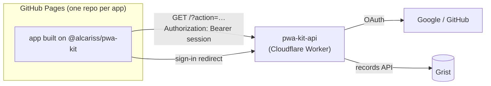

# pwa-kit

Shared foundation for my micro PWAs (period, Hlášky, BeeBusy, …): installable,
offline-capable apps hosted on GitHub Pages, with data in Grist and sign-in with
Google or GitHub.

| Piece | Where | What it replaces in each app |
|---|---|---|
| `@alcariss/pwa-kit` | `src/` | `vite.config.ts`, `tsconfig.json`, `config.ts`, `api.ts`, `cache.ts`, the `*-store.ts`, the update prompt, `escapeHtml`, the debug panel, date helpers |
| Grist worker | `worker/` | one `google-apps-script-v2.gs` or `hanushlasky-api` per app |
| Deploy workflow | `.github/workflows/deploy-pages.yml` | each app's `deploy.yml` |
| Starter app | `template/` | copying the last app and renaming things |



## Start a new app

Use Node 24 (npm 11). npm 10.9 crashes on a fresh install of this toolchain
(`Cannot read properties of null (reading 'edgesOut')`); installs from an
existing lockfile are fine on either.

1. **Copy the template** into a new repo:
   ```bash
   npx degit Alcariss/pwa-kit/template my-app
   cd my-app && git init && npm install
   ```
2. **Name it.** Edit `name` in `package.json`, the manifest fields in
   `vite.config.ts`, `<title>` and `theme-color` in `index.html`, `APP_NAME` in
   `src/main.ts`, and the cache key `notes:v1:items` (apps on one GitHub Pages
   origin share `localStorage`, so it must be unique).
3. **Icon.** Replace `public/logo.svg`, then `npm run icons`.
4. **Data model.** Rewrite `src/notes.ts` for your record type, and add an
   entry for the app in `worker/src/apps.ts` (see below).
5. **Run locally.** `cp .env.example .env`, point `VITE_API_URL_PRIMARY` at
   `https://<worker>/<app-id>`, then `npm run dev`.
6. **Deploy.** Push to GitHub, enable *Settings → Pages → Source: GitHub
   Actions*, and add the repository secret `VITE_API_URL_PRIMARY`. The
   template's `deploy.yml` calls the shared workflow, which tests, builds with
   the right base path and version, and deploys.

## The worker (one-time setup)

One Cloudflare Worker serves every app. It signs users in with Google or
GitHub, checks the email against a per-app allowlist, and reads and writes the
app's Grist table. The Grist API key and OAuth secrets never reach the browser.

1. **Grist:** create an API key (*Profile settings → API*). For each app create
   a table whose columns match its entry in `apps.ts`. Store dates in **Text**
   columns as `YYYY-MM-DD`.
2. **Google:** in Google Cloud Console, create an *OAuth client ID* of type
   *Web application* with the redirect URI `https://<worker>/auth/callback`
   (add `http://localhost:8787/auth/callback` for `wrangler dev`). While the
   consent screen is in *Testing*, add every user as a test user; or publish it
   (the `email` scope needs no review).
3. **GitHub:** *Settings → Developer settings → OAuth Apps → New*, callback URL
   `https://<worker>/auth/callback`. GitHub allows one callback per OAuth app,
   so use a second app for local development.
4. **Deploy:**
   ```bash
   cd worker && npm install
   npx wrangler login
   npx wrangler deploy
   openssl rand -base64 48 | npx wrangler secret put SESSION_SECRET
   npx wrangler secret put GRIST_API_KEY
   npx wrangler secret put GOOGLE_CLIENT_ID      # and GOOGLE_CLIENT_SECRET
   npx wrangler secret put GITHUB_CLIENT_ID      # and GITHUB_CLIENT_SECRET
   npx wrangler secret put ALLOWED_EMAILS_NOTES  # me@example.com,partner@example.com
   ```

### Adding an app to the worker

Add an entry to `worker/src/apps.ts`, keyed by the app id (the last path
segment of its API URL):

```ts
'time-tracker': {
  origins: [GITHUB_PAGES],
  grist: { documentId: 'abc123', tableId: 'Entries', sort: '-date,-start_time' },
  fields: {
    date: { type: 'date', required: true },
    startTime: { type: 'text', column: 'start_time', required: true },
    hours: { type: 'number', required: true },
    activity: { type: 'text', maxLength: 500 }
  },
  timestamps: { createdAt: 'created_at', updatedAt: 'updated_at' },
  ownerColumn: 'owner' // optional: each user sees only their own rows
}
```

Then `npx wrangler secret put ALLOWED_EMAILS_TIME_TRACKER` and `npx wrangler
deploy`. The worker rejects unknown fields, missing required fields, invalid
dates and non-numbers before calling Grist.

### Sign-in

1. The app sends the browser to `/auth/login?app&provider&return_to`.
2. The worker checks `return_to` against the app's `origins` and `DEV_ORIGINS`,
   sets a short-lived nonce cookie, and redirects to the provider.
3. On `/auth/callback` it checks the signed state and the nonce cookie, takes
   the provider's **verified** email, and checks it against
   `ALLOWED_EMAILS_<APP>`.
4. It redirects to `return_to#session=<token>`: a 90-day HS256 token bound to
   the app. The fragment never reaches a server, and the app removes it from
   the address bar at once.
5. The app sends `Authorization: Bearer <token>` on every request.

Taking an email off the allowlist revokes that user on their next request.
Rotating `SESSION_SECRET` signs everyone out. Sign-out is local: it forgets the
session and the offline copy.

## Using the kit

```ts
const config = readApiConfig(import.meta.env);           // VITE_API_URL_PRIMARY, VITE_AUTH_PROVIDERS, …
const auth = createAuth({ apiUrl: config.primaryUrl });
const client = createApiClient(config, { getSessionToken: () => auth.current()?.token ?? null });
const store = createStore({
  resource: createResource(client, { mapRow: toNote, toParams: toNoteParams }),
  cache: createCache<Note>('notes:v1:items')
});
setupUpdatePrompt(registerSW);                           // from 'virtual:pwa-register'
```

- `store.refresh()` / `create()` / `update()` / `remove()` return
  `{ items, diagnostics }`. When the server is unreachable, `refresh()` returns
  the cached copy with `diagnostics.source === 'cache'`. An expired or revoked
  session is thrown as `ApiError` with code `UNAUTHENTICATED` or `FORBIDDEN`,
  never hidden behind the cache.
- `client.request(action, params)` calls custom actions beyond the CRUD four.
- `definePwaApp({...})` from `@alcariss/pwa-kit/vite` is the whole Vite config.
  The service worker precaches the app shell and does **not** cache API
  responses: its cache is keyed by URL, not user, so it would show one user's
  data to the next.
- `@alcariss/pwa-kit/styles.css` styles the login screen, update banner and
  debug panel (`?debug=1`). Override the `--pk-*` custom properties.
- `tsconfig.base.json` is the shared compiler config to `extends`.

### Apps still on Apps Script

The client still speaks the Apps Script contract. Leave `VITE_AUTH_PROVIDERS`
empty and set `VITE_API_TOKEN` (and `VITE_API_URL_FALLBACK` if used). No
sign-in screen is shown, the token is sent as `?token=`, and no
`Authorization` header is sent (Apps Script cannot answer the CORS preflight it
would trigger). That token is compiled into public JavaScript, so it only keeps
out casual traffic. Moving to the worker is what makes the data private.

## Developing the kit

```bash
npm install && npm run typecheck && npm test        # kit
cd worker && npm install && npm run typecheck && npm test
```

CI runs both and builds the template against the packed kit.

### Releasing

```bash
npm run release -- 1.1.0
git push origin main v1.1.0 && git push --force origin v1
```

Apps depend on `github:Alcariss/pwa-kit#semver:^1.0.0`, which npm resolves
against the `vX.Y.Z` tags, so the release commit carries a prebuilt `dist/`. No
build or install script runs on the app's side. `v1` follows the latest 1.x
because apps call the deploy workflow `@v1`. A breaking change is `2.0.0`, and
each app moves when its `package.json` and `deploy.yml` say so.
